# Art pass: a stylised, game-like character

Date: 2026-11-20. Branch `feat/art-pass`, on top of `spike/scan`. Everything here is synthetic people only. The
"before" images are the spike's (on `spike/scan`); the "after" images are re-rendered by the repo's generator and
checked by the image guard.

## What changed

- **Four styles**, exposed through `engine.restyle(character, { style, stylize, outfit, hair, colors })` and
  `scan(input, { look })`: `soft-toon`, `cel-outline`, `low-poly`, `clay`. A style is data (ramp steps and levels,
  outline width and colour, rim strength, flat shading, saturation, clay tint) carried in every material's
  `extras.eskais`. `eskais-character/three` (new subpath, three as an optional peer) turns it into `MeshToonMaterial`
  with the ramp as a gradient map, a colour-tinted rim light, and an **inverted-hull outline**, chosen over a
  post-process edge pass for mobile: the hull is one more vertex pass per mesh with front faces culled, while an edge
  pass needs full-resolution depth and normal targets and a full-screen pass every frame. The hull follows morphs and
  skinning (pushed out before both) and shares the mesh's live morph weights. Light and dark backgrounds both work:
  the outline is a near-black ink and the rim tints the surface's own colour instead of adding white, so dark skin
  gets a warm edge, not a halo.
- **Stylised proportions** behind `stylize` (0–1, default 0.5): a larger head (up to +16%), larger and rounder eye
  regions, a smaller nose, mouth and chin. The face part goes through face-modifier weights (still a morph-target
  number); the head and eye scaling is a smooth deformation that also moves the joints and eyes. At 0 the fit is
  untouched (tested).
- **Toon face:** face normals blend towards an ellipsoid around the head (more with `stylize`), so cel bands read as
  clean shapes instead of every nose and cheek bump; the GLB carries these normals, so any toon shader benefits.
  Eyes are rebuilt as toon eyes: a larger iris in the sampled colour with a darker rim and lighter lower half, a black
  pupil and a painted highlight.
- **Brow colour bug fixed.** Two causes: the sampler took the darkest pixels near MediaPipe's brow landmarks (shadowed
  skin when brows are lighter than the skin, as for grey or ginger brows on darker skin), and the synthetic painter
  placed brows higher than real brows sit relative to those landmarks. Now the sampler searches a band above the
  landmarks and keeps the pixels least like the skin, and the painter puts brows where they belong.
- **Hair:** the procedural placeholder is replaced by **eight CC0 MakeHuman styles** (crop, side part, short afro,
  bob, fringe bob, long straight, ponytail, braid) plus `buzz` (painted) and `none`. The bake (`tooling/bake/hair`)
  downloads the pinned packs, fits each style with MakeHuman's own proxy fitting, re-binds every hair vertex to three
  Anny vertices, and turns the cards' alpha into opaque geometry (near-transparent faces dropped, ragged quads
  tapered, brightness kept as a per-vertex shade). No texture or image is committed. Hair follows any fitted or
  stylised head, and is skinned from the vertices it hangs from, so long hair moves with the neck and back.
- **Outfit**, made in this repo: a tee (or a hoodie) and joggers with sneakers, built as shells of the fitted body
  (vertices pushed out along their normals by each garment's ease, membership smoothed over the mesh for clean hems
  and no cracks), so it follows every morph and the rig with no extra skinning. The underwear body stays internal:
  `outfit: "none"` is accepted but not offered in `character.look.outfits`.
- **Clips:** `idle` and `wave`, written as glTF animations on the 104-joint rig (demo assets only for now).

## Before and after

Before (spike): [face](https://github.com/p-otero/eskais-character/blob/spike/scan/docs/images/s000-face.png),
[body](https://github.com/p-otero/eskais-character/blob/spike/scan/docs/images/s001-body.png): smooth-shaded
mannequin, procedural hair.

After, the same synthetic people scanned end to end, in every style (turntable at 0°, 45°, 90°, 180°, and a portrait):

| Style            | Person 1                                                                                     | Person 2                                                                                     |
| ---------------- | -------------------------------------------------------------------------------------------- | -------------------------------------------------------------------------------------------- |
| Soft toon        |  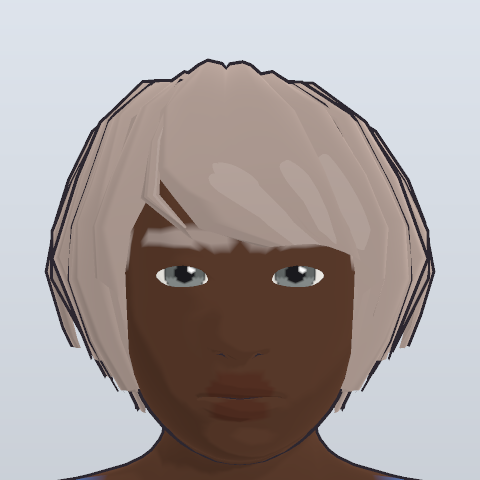     | 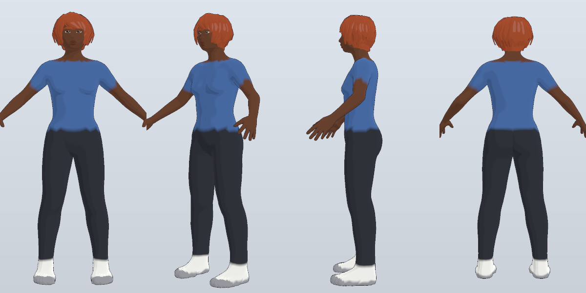 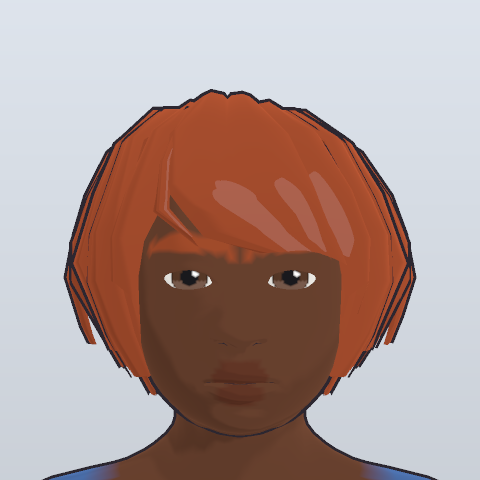     |
| Cel with outline | 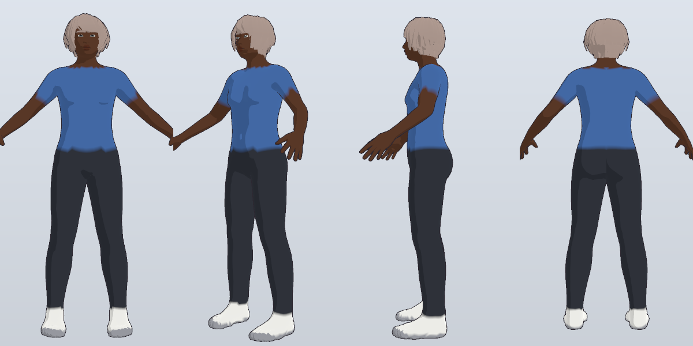 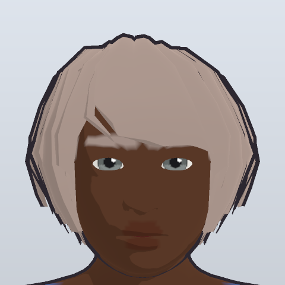 | 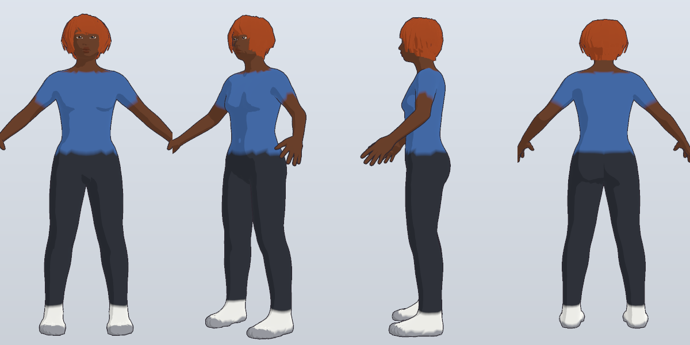 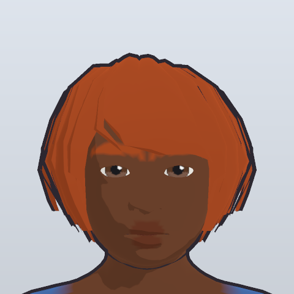 |
| Low-poly         | 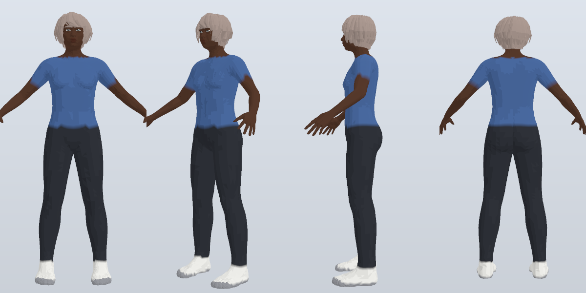 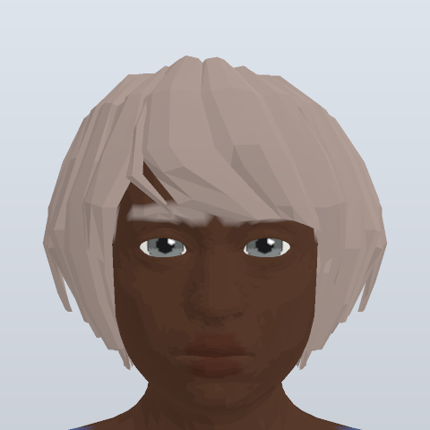       | 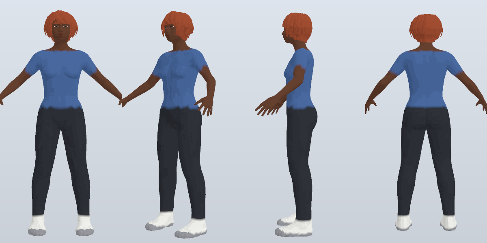 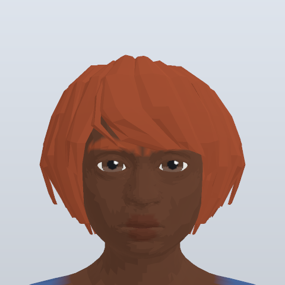       |
| Clay             | 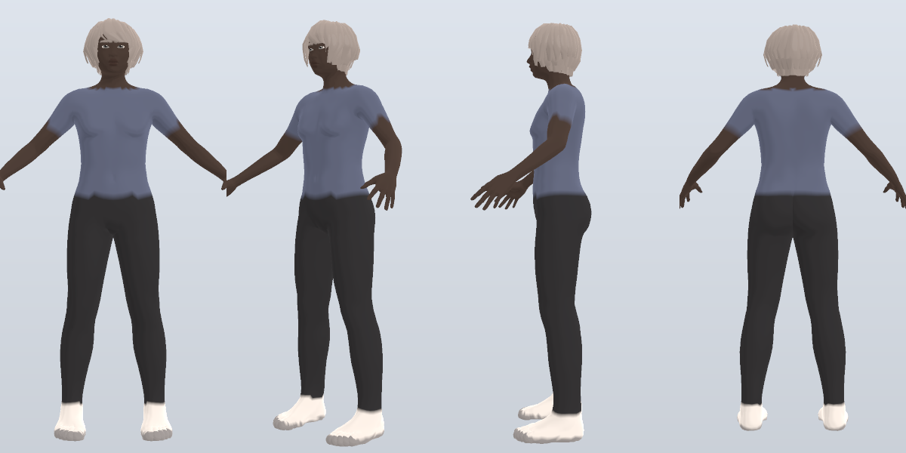 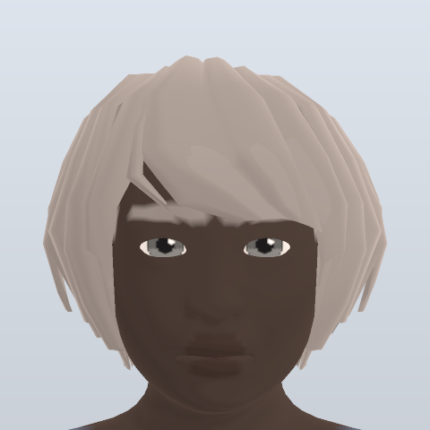               | 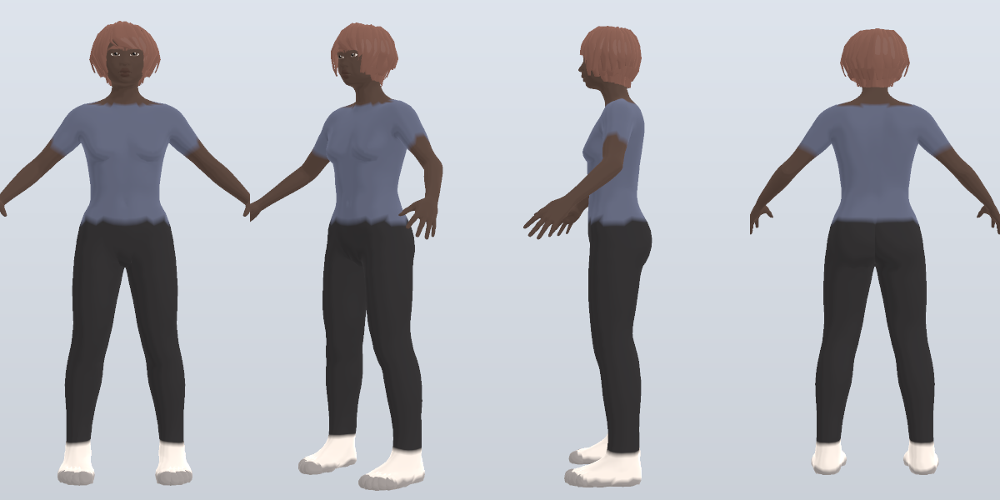 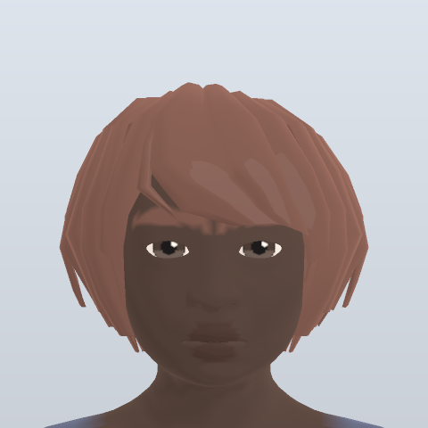               |

The truth-vs-fit side by sides (`images/s00N-face.png`, `-body.png`) are regenerated with the new hair and brows.
These report renders come from the repo's deterministic software renderer, which implements the same presets as the
three.js materials (the browser test renders all four through three.js on SwiftShader).

## Measurements (held-out synthetic people, seed 1, 24 scans, same machine as the spike report)

|                                                | Spike                 | Art pass                          |
| ---------------------------------------------- | --------------------- | --------------------------------- |
| Scan, median total (CPU delegate)              | 192 ms                | 184 ms                            |
| Export stage (base + final GLB)                | 51 ms                 | 62 ms                             |
| Main-thread tasks > 50 ms                      | 0                     | 0                                 |
| Memory, page + worker                          | 94 MiB                | 102 MiB                           |
| Character GLB                                  | 5.9 MB                | 6.1 MB (eyes and hair are richer) |
| Download, first use (brotli)                   | 15.1 MB               | 15.3 MB (+0.19 MB hair)           |
| Face head RMS vs truth (neutral face: 4.10 mm) | 2.69 mm               | 2.87 mm                           |
| Body vertex RMS with height hint               | 7.1 mm                | 8.0 mm                            |
| Skin / eyes / hair / brows ΔE (median)         | 4.1 / 5.0 / 4.0 / 3.2 | 3.7 / 6.1 / 4.7 / 3.7             |
| Beard presence                                 | 96%                   | 92%                               |

- The fits got slightly worse, and that is the synthetic photos getting harder, not the code: the new hair covers
  foreheads, face edges and sometimes an eye, as real hair does, so MediaPipe sees less (face prior R²: eye spacing
  0.75 → 0.43, head width 0.48 → 0.46). The iris error rose for the same reason (an eye under a fringe). Brows improved
  on the cases the bug was about; their mean ΔE on the 300-person colour set is 6.1 (was 7.6).
- **Hair choice from the photo is now weak**: the right length class (none, buzz, short, medium, long) 46% of the
  time held out, the exact style 25%. Real MakeHuman hair mostly falls behind the shoulders, out of a front face
  crop. The user can switch styles (`restyle` or the UI); the next step below gives a better signal.
- GPU delegate (RTX 5070 Ti): 193 ms total; phone emulation (main thread throttled 4×; CDP can't throttle the worker,
  as before): 246 ms. Neither is a phone measurement.
- `restyle` costs one export (~60–80 ms in the worker) and transfers the new GLB; nothing touches the network.

## Licences of the new assets (all checked 2026-11-20)

| Asset                                                                                                                                      | Licence         | Source                                                                                                                                                                                                                                                                                               |
| ------------------------------------------------------------------------------------------------------------------------------------------ | --------------- | ---------------------------------------------------------------------------------------------------------------------------------------------------------------------------------------------------------------------------------------------------------------------------------------------------- |
| crop (`short02`), side part (`short03`), short afro (`afro01`), bob (`bob02`), long (`long01`), ponytail (`ponytail01`), braid (`braid01`) | CC0-1.0         | MakeHuman system assets, [pack](https://files.makehumancommunity.org/asset_packs/makehuman_system_assets/makehuman_system_assets_cc0.zip), [asset packs page](https://static.makehumancommunity.org/assets/assetpacks/index.html); each `.mhclo` says "explicitly released as CC0 in september 2020" |
| fringe bob (`littleright_bobcut_hair`)                                                                                                     | CC0-1.0         | MakeHuman Hair 01, [pack](https://files.makehumancommunity.org/asset_packs/hair01/hair01_cc0.zip), listed CC0 on the asset packs page and in the pack's `hair01.json`                                                                                                                                |
| Outfit, styles, toon eyes, stylisation, clips                                                                                              | MIT (this repo) | Made here                                                                                                                                                                                                                                                                                            |
| `demo-assets/`                                                                                                                             | CC0-1.0         | Synthetic person, CC0 Anny/MakeHuman data, CC0 hair, our outfit and clips                                                                                                                                                                                                                            |

Both zips are pinned by SHA-256 and size in `assets/ASSETS.json`; the CC-BY packs (Hair 02/03) are not used. Details
in [licences.md](licences.md).

## Real-photo test (local only)

`bun run scan:photo -- --face face.jpg [--body body.jpg] [--height 175]` runs a real photo through the engine in
headless Chrome on the owner's machine: every request outside the local files is aborted, the photo stays in memory,
and the output (a GLB plus front and side renders per style, and the fitted parameters) goes to the git-ignored
`.local/scans/`. The script refuses to run if that folder isn't ignored. README "Try it on your own photo" has the
steps. It was exercised here only with a synthetic fixture standing in for a photo.

## Demo assets for the UI library

In `demo-assets/` (CC0, `LICENSE.md` and `README.md` there):

| Path                                           | Size                                             |
| ---------------------------------------------- | ------------------------------------------------ |
| `demo-assets/character-soft-toon.glb`          | 988,628 bytes (529,718 gzip)                     |
| `demo-assets/character-cel-outline.glb`        | 988,616 bytes                                    |
| `demo-assets/photo-face.png`, `photo-body.png` | 124,800 / 115,900 bytes                          |
| `demo-assets/scan-replay.json`                 | 18 KB: the recorded event stream with timestamps |

- Plain glTF with `KHR_mesh_quantization` only: the UI library's `GLTFLoader` (no meshopt or Draco decoder
  configured) loads them as they are; verified in three.js, including the `wave` and `idle` clips.
- 23 morph targets: `body.pc00`–`pc02`, four face modifiers (`incr`/`decr`), and 12 ARKit expressions. To fit 1 MB
  the targets are normalized bytes scaled per target, so weights are sent as `weight × extras.targetScales[i]`; the
  replay's weights and the mesh's default weights are already scaled. Normals are bytes; positions stay float because a
  stylised head reaches past what a normalized short holds.

## Next steps

1. **Hair length from the body photo:** the pose model's person mask shows hair over the shoulders and back; measure
   it there instead of in the face crop, and let a small classifier pick the shape. The user's choice stays the
   final word.
2. **Real-device runs** (still owed from the spike) with the new export, and an outline-width check at phone DPI.
3. **Hair quality:** long and braid drift 2–3 cm on extreme bodies (MakeHuman's helper shell vs Anny's skin); refit
   those two against a wider body set, and add 2–3 more CC0 styles (curly, buns).
4. **Clothing:** give the hoodie a hood and the tee a looser hem by adding real garment geometry fitted the same way
   as the hair, keeping the body-shell outfit as the cheap default.
5. **Motion:** proper bone orientations, then CMU-mocap clips retargeted onto the rig for the gym exercises.
