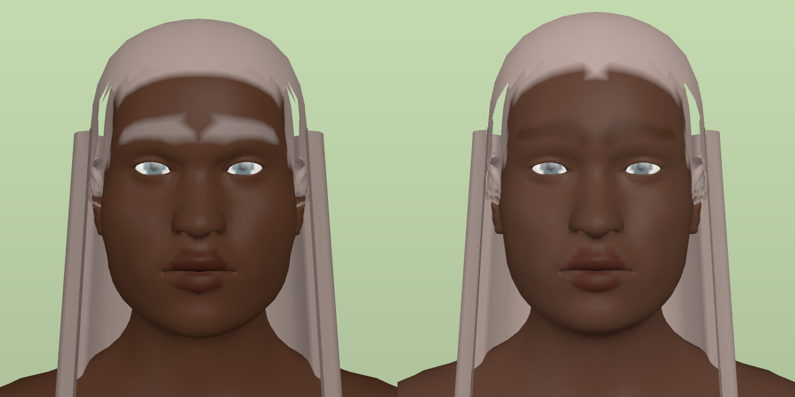
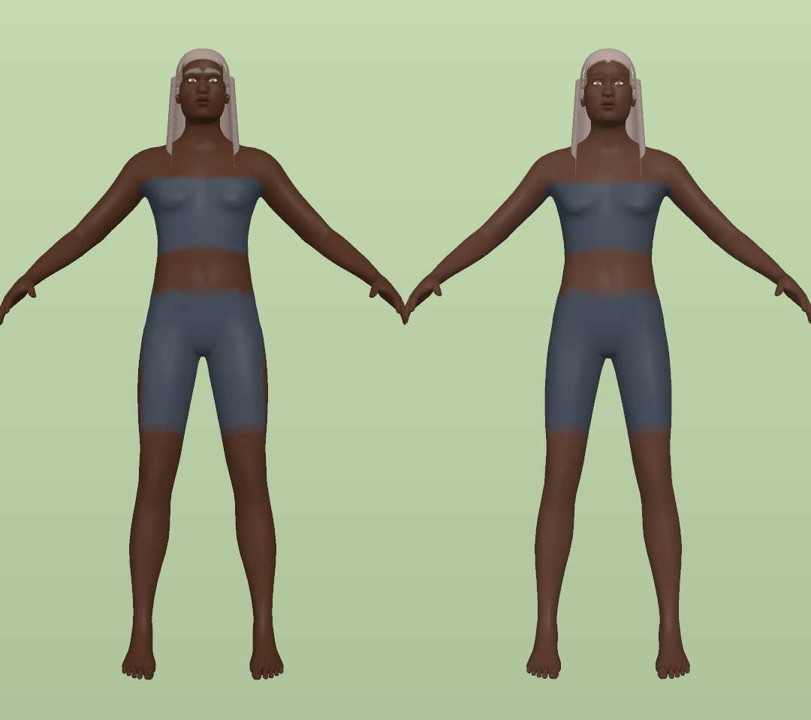
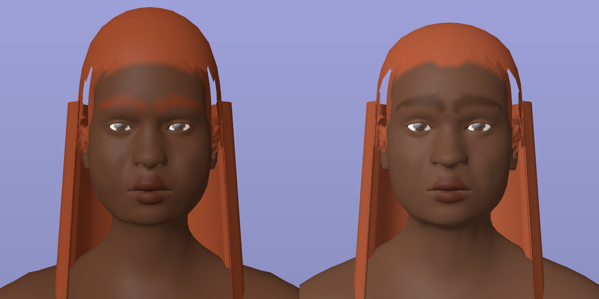
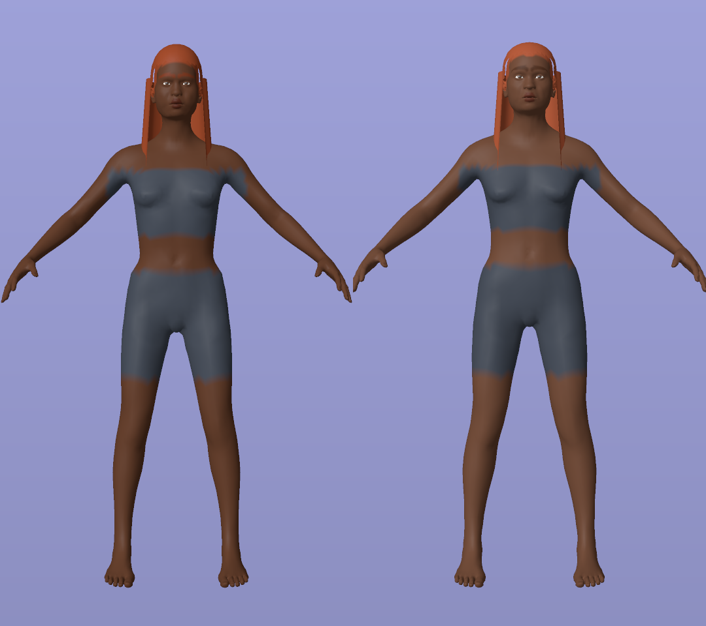
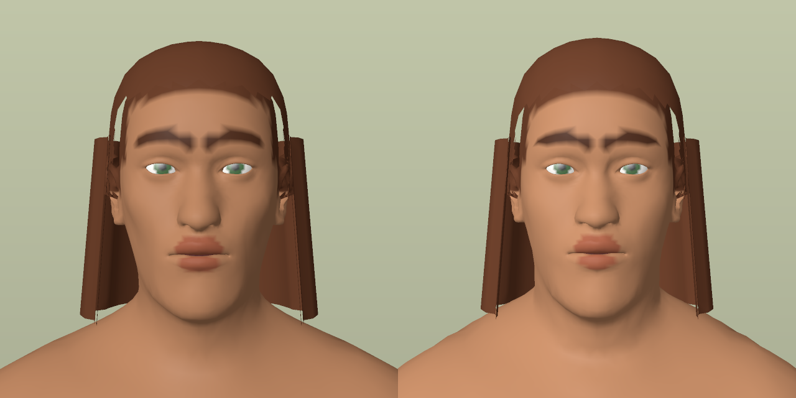
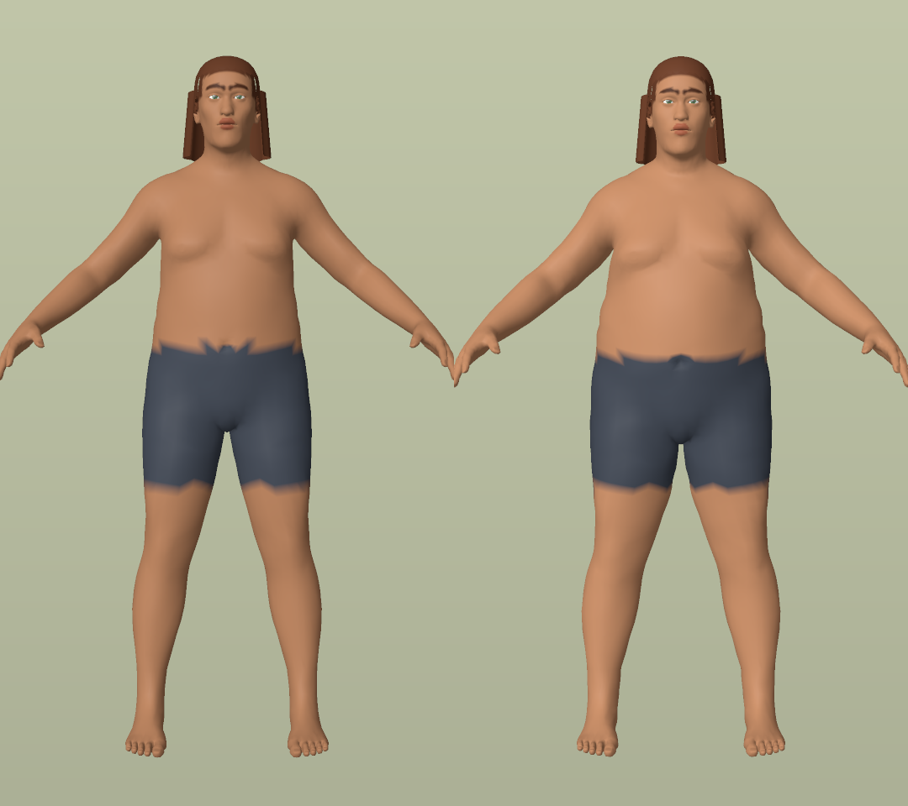
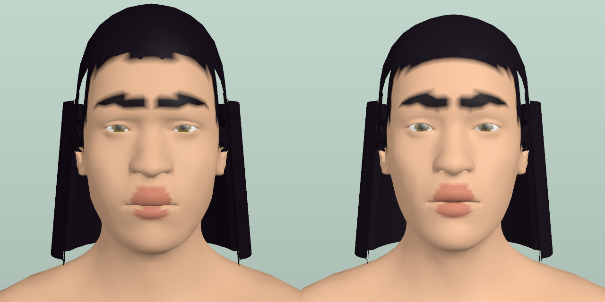
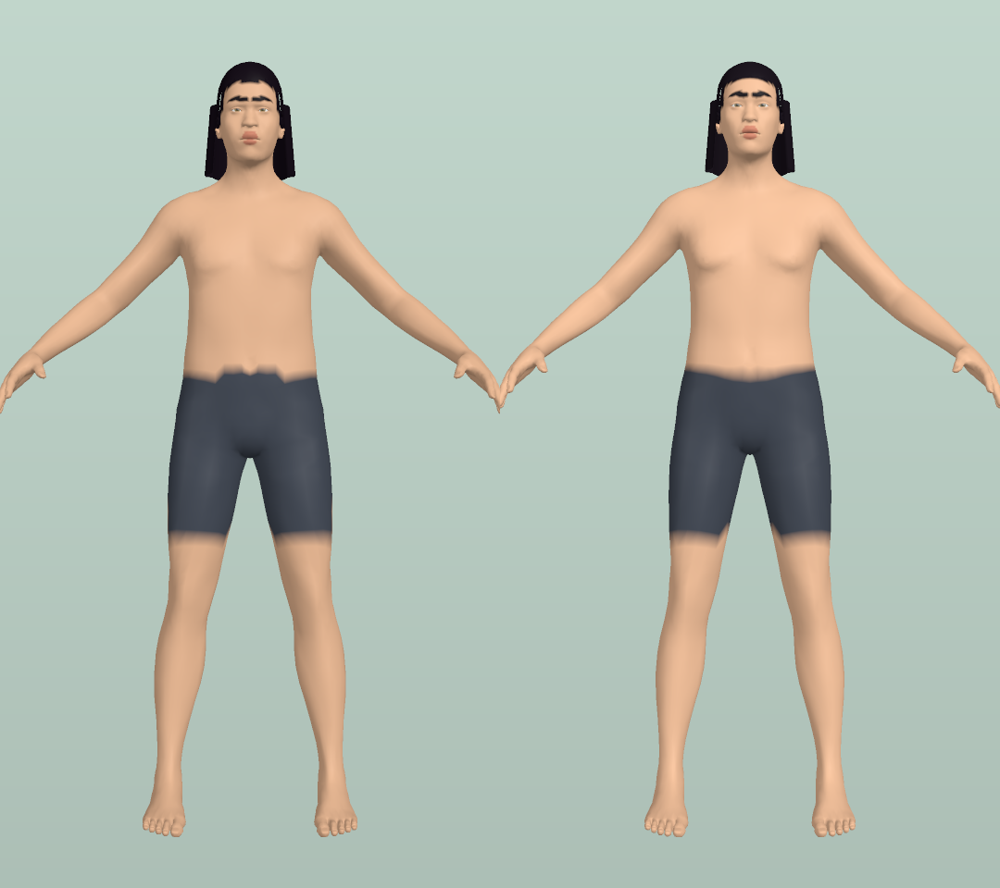

# Spike report: photo → stylised, rigged character, in the browser

Date: 2026-11-19. Branch `spike/scan`. Everything below was measured in this repo with the scripts named in
"Reproduce"; the test people are synthetic (rendered from Anny with known parameters), never real photos.

## Verdict

The approach works end to end in the browser, privately and fast: a face photo and a body photo become a skinned,
morphable GLB with fitted proportions, a fitted face, sampled colours and a hair choice in **about 0.2 s of compute on
a desktop** after a one-off **15 MB (brotli) model download**, with **no main-thread task over 50 ms** and **no
network request during a scan**. Body proportions and colours recover well. The weak part is the **face**: MediaPipe's
landmarks only see about half of Anny's face modifiers, so the face looks like the person in broad strokes (width,
eye spacing, mouth width, jaw, chin) but not in fine detail. That is acceptable for a stylised character and is where
the next work should go.

## What was built

```
face photo ─┐                 Web Worker (module)                                         main thread
            ├─ ImageBitmap ─► MediaPipe Face Landmarker (478 pts + 52 blendshapes) ─► landmarks event ─► UI
body photo ─┘                 MediaPipe Pose Landmarker full (33 pts + person mask)  ─► landmarks event ─► UI
                              colour sampling (pixels in memory, then dropped)
                              base GLB (mean shape, 132 morph targets)               ─► model event ────► UI
                              body fit: learned prior → Levenberg-Marquardt on 6 phenotypes ─► progress weights
                              face fit: learned prior → Umeyama + bounded ridge on 15 modifiers ─► progress weights
                              hair pick, final GLB (fitted skeleton, weights, eyes, hair)  ─► done event
```

- **Base model:** NAVER Anny 0.6.2 baked at build time (Python, `tooling/bake`) into `assets/anny/anny.bin`
  (5.2 MB raw, 1.1 MB brotli): a 16-component PCA basis of adult bodies driven exactly by Anny's six phenotypes
  (gender, age, muscle, weight, height, proportions; 0.41 mm RMS PCA error), 32 face modifiers (left/right tied), the
  52 ARKit-named Face Units expressions and the 104-bone rig, converted to glTF axes. The TypeScript evaluator
  reproduces Anny's own vertices (`test/unit/anny.test.ts`).
- **Shape is morph targets + weights.** The GLB's body mesh carries 132 targets (`body.pc00…15`,
  `face.<modifier>.incr/decr`, `expr.<ARKit name>`), quantized (KHR_mesh_quantization) and sparse on the head. Every
  `progress` event is a weights vector aligned with `targetNames`, so the UI morphs by setting numbers.
- **Rig:** 104 joints with skin weights (top 4 per vertex). The fitted GLB places the skeleton for the fitted shape.
  Joints are identity-oriented in the rest pose (fine for display, see "Next steps" for animation).
- **Face:** fitted modifiers plus the 52 expression targets, so the character can be animated with ARKit-style
  weights (MediaPipe's own blendshape output maps 1:1).
- **Toon-friendly output:** vertex-coloured skin (lips, brows, scalp, beard painted by region), procedural eyes with
  the sampled iris colour, materials tagged `extras.toon`, roughness 1. The demo renders it with `MeshToonMaterial`.
- **Hair:** a placeholder catalogue of five procedural styles built on the fitted head (none, buzz, short, medium,
  long), picked from the photo; the user can switch (`character.hair.options`). The verified CC0 catalogue
  (MakeHuman "Hair 01") is the next step.
- **Synthetic data generator:** a deterministic software rasterizer renders Anny people with known phenotype, face
  modifiers, skin tone (eight-stop ramp from very light to very deep), eye, hair, brow and beard colours, hair style
  and lighting, as a 640×640 face photo and a 540×960 A-pose body photo in fitted clothes. CI re-renders every
  committed image and fails on anything the generator did not produce.

## Accuracy on held-out synthetic people

24 people (seed 1) never used for training or calibration, scanned end to end through the real engine in Chrome
(`bun run perf`). Calibration used separate seeds (1000 face map, 2000 body calibration, 4000 priors, 300 people).

### Body (phenotypes in Anny's 0–1 scale; "average" = always answering the average body)

| Phenotype               | MAE, scan | MAE, scan + height hint | MAE, average | Held-out R² of the prior |
| ----------------------- | --------- | ----------------------- | ------------ | ------------------------ |
| gender                  | 0.112     | 0.121                   | 0.202        | 0.64                     |
| age (adult range 0.6–1) | 0.047     | 0.046                   | 0.082        | 0.53                     |
| muscle                  | 0.123     | 0.125                   | 0.193        | 0.57                     |
| weight                  | 0.148     | 0.143                   | 0.234        | 0.44                     |
| height                  | 0.076     | **0.019**               | 0.244        | 0.82                     |
| proportions             | 0.115     | 0.105                   | 0.209        | 0.65                     |

Whole-body vertex RMS against the true shape: **58 mm** without a height hint (mostly overall scale: stature MAE
7.4 cm), **7.1 mm** with the user's height, against 197 mm for the average body. A photo carries no absolute scale, so
the API takes an optional `hints.heightCm`.

### Face

| Metric                                              | Scan        | Neutral face |
| --------------------------------------------------- | ----------- | ------------ |
| Head-surface RMS vs true face (4,675 head vertices) | **2.69 mm** | 4.10 mm      |
| Modifier MAE, all 32                                | 0.176       | 0.183        |
| Modifier MAE, the 15 observable ones                | 0.167       | 0.186        |

MediaPipe's landmarks respond to some modifiers and not others. Held-out R² of the learned prior: eye spacing 0.75,
mouth width 0.66, head fat 0.61, head angle 0.50, head width 0.48, chin height 0.48, epicanthus 0.48, mouth height
0.39, brow angle 0.31, head height 0.30, nose length 0.25, eye size 0.24, eye height 0.21, nose position 0.21, nose
width 0.15; forehead, cheeks, nose depth and tip, lips' thickness, chin width and prominence, jaw drop: ~0. The
scan moves only the 15 observable modifiers (R² ≥ 0.15) and leaves the rest at the prior, which is what cut the
head error by a third. The geometric fit alone (no learned prior) only reached 3.54 mm; with perfect landmarks it
recovers modifiers almost exactly (MAE 0.05), so the limit is what MediaPipe sees, not the solver.

### Colours and hair (300 held-out people, seed 4000; CIE76 ΔE, under 5 is hard to tell apart side by side)

|             | Median ΔE | Mean ΔE                                            |
| ----------- | --------- | -------------------------------------------------- |
| Skin        | 3.3       | 3.8                                                |
| Eyes (iris) | 3.8       | 4.8                                                |
| Brows       | 4.1       | 7.6                                                |
| Hair        | 4.1       | 11.3 (misses when hair is close to the background) |

Beard present/absent: 88% (57 bearded). Hair style (5 classes): 71%; the face photo is cropped at the shoulders,
so medium and long confuse most. Skin is sampled with the photo's lighting, so it reads slightly lighter than the
albedo; a white-balance step is a cheap improvement.

### Visual side by side

Left: the synthetic person; right: the character the scan produced, same camera and light (`bun run side-by-side`,
re-rendered and checked by the image guard). Each body image is framed to its own height, so the missing scale
without a height hint doesn't show here.

|                                    |                                    |
| ---------------------------------- | ---------------------------------- |
|  |  |
|  |  |
|  |  |
|  |  |

## Performance

Machine: Windows 11 desktop, AMD Zen 5 CPU, NVIDIA RTX 5070 Ti, Chrome 157 headless through Playwright. Times are
medians over 24 warm scans; "models ready" loads from local files (download time excluded, see sizes).

| Stage (ms)                    | CPU delegate (SwiftShader WebGL) | GPU delegate (RTX 5070 Ti) | Phone emulation* |
| ----------------------------- | -------------------------------- | -------------------------- | ---------------- |
| detect face                   | 12                               | 13                         | 16               |
| colours                       | 20                               | 20                         | 25               |
| detect body                   | 35                               | 26                         | 38               |
| fit body                      | 35                               | 51                         | 37               |
| fit face                      | 14                               | 16                         | 38               |
| export (base + final GLB)     | 51                               | 53                         | 62               |
| **total scan**                | **192**                          | **185**                    | **262**          |
| models ready (compile, local) | 675                              | 473                        | 598              |
| main-thread tasks > 50 ms     | 0                                | 0                          | 0                |
| memory, page + worker         | 94 MiB                           | 95 MiB                     | 60 MiB           |

- **Cold first scan:** the first detection compiles the model: 99 ms face and 185 ms body on the CPU delegate.
  On SwiftShader the GPU delegate's first inference took 1–2 s, so `delegate: "auto"` now picks the CPU when WebGL is
  a software rasteriser (tested).
- **GPU vs CPU:** at these image sizes MediaPipe is already fast on the CPU (XNNPACK); the GPU saves ~10 ms on the
  body. Fitting is 30–50 ms of plain TypeScript; a WebGPU path is not worth it yet (not built).
- ***Phone emulation** is Chrome's Pixel 7 profile with 4× CPU throttling, but CDP throttles the page's main thread
  only; it cannot throttle a worker target (tried `Target.attachToTarget` + `Emulation.setCPUThrottlingRate`), so the
  worker stages above ran at desktop speed. **The phone number is therefore not a phone measurement.** Estimate for a
  mid-range phone (5–8× slower single-thread than this desktop): 1–1.5 s per scan plus 3–6 s to compile the models;
  for a mid-range laptop (2–3×): 0.4–0.6 s plus 1–2 s. Both need confirming on real devices.

### Download (first scan; cached afterwards)

| File                                         | Raw                | gzip               | brotli             |
| -------------------------------------------- | ------------------ | ------------------ | ------------------ |
| MediaPipe WASM + loader                      | 15.0 MB            | 4.2 MB             | 3.0 MB             |
| Face Landmarker model                        | 3.8 MB             | 3.3 MB             | 3.1 MB             |
| Pose Landmarker full (lite: 5.8 / 5.0 / 4.6) | 9.4 MB             | 8.4 MB             | 7.8 MB             |
| Anny body model                              | 5.2 MB             | 1.7 MB             | 1.1 MB             |
| Engine worker bundle                         | 0.45 MB            | 0.15 MB            | 0.13 MB            |
| **Total (full pose / lite pose)**            | **33.8 / 30.2 MB** | **17.8 / 14.4 MB** | **15.1 / 11.9 MB** |

The models are already compressed (float16 TFLite), so only the WASM and Anny shrink much. Character GLB: 5.9 MB raw,
1.6 MB gzip, 0.94 MB brotli.

## Does it run on a mid-range laptop and a phone?

- **Desktop Chrome:** measured, yes (above). Electron uses the same Chromium; not tested separately.
- **Mid-range laptop:** not measured on one. Compute and memory (≈ 95 MiB) are small enough that it should, see the
  estimate above.
- **Phone:** only emulated (viewport, main-thread throttling; the worker is not throttled), so **not demonstrated**.
  Risks to check on a device: the 15 MB download on mobile data, WASM compile time, and WebGL2 availability.
- **Requirement found:** MediaPipe Tasks for Web needs WebGL2 even on its CPU delegate (with WebGL fully disabled,
  `detect()` crashes inside MediaPipe). The engine checks WebGL2 up front and rejects `ready` with a
  `CapabilityError` (tested). Chrome provides SwiftShader when the GPU is blocklisted, so this is rare.

## What works

- The full event stream, in a module worker, with zero main-thread long tasks and zero requests during a scan.
- Pinned, SHA-256-verified downloads; the only network code is `src/scan/loader.ts` (enforced by lint).
- Body proportions from one A-pose photo; stature from an optional height.
- Colours (skin, eyes, brows, hair) within a few ΔE; beard detection.
- A valid, skinned, morphable GLB (Khronos validator: no errors, no warnings) with ARKit-named expressions.
- MediaPipe detects every synthetic render (24/24, 32/32, 300/300 faces and bodies) across all skin tones tried.

## What doesn't (yet)

- **Fine face shape.** Half the face modifiers are invisible to MediaPipe's landmarks; nose depth, lip thickness and
  cheeks don't transfer.
- **Domain gap.** All calibration and priors are learned on synthetic renders. Real photos differ (lighting, clothes,
  hair, lens); the per-feature calibration and priors need re-checking on real data before relying on them, and that
  data must be consented and stay out of the repo.
- **Hair** is a placeholder (procedural, blocky) and the style classifier mixes medium and long.
- **Perspective:** the body camera in the synthetic set is 3.6 m away; close selfies would bias widths.
- **Rig orientation:** joints are identity-oriented; retargeting will want Anny's bone frames.

## Licences

All runtime components allow commercial use and redistribution; details, links and dates are in
[`licences.md`](licences.md) and the notices in [`LICENSES.md`](../LICENSES.md).

| Component                                        | Licence                                                         | Commercial          | Checked    |
| ------------------------------------------------ | --------------------------------------------------------------- | ------------------- | ---------- |
| NAVER Anny 0.6.2 code                            | Apache-2.0                                                      | Yes                 | 2026-11-19 |
| MakeHuman/MPFB2 assets and Face Units (via Anny) | CC0-1.0                                                         | Yes                 | 2026-11-19 |
| `@mediapipe/tasks-vision` 1.2.3 (JS + WASM)      | Apache-2.0                                                      | Yes                 | 2026-11-19 |
| Face Landmarker, Pose Landmarker models          | Apache-2.0 (model cards)                                        | Yes                 | 2026-11-19 |
| three.js 0.187.0 (demo only)                     | MIT                                                             | Yes                 | 2026-11-19 |
| MakeHuman "Hair 01" (planned catalogue)          | CC0-1.0                                                         | Yes                 | 2026-11-19 |
| CMU mocap (planned motion source)                | custom: in products yes, resale no                              | Yes, with condition | 2026-11-19 |
| FLAME                                            | non-commercial (2023 Open: CC-BY-4.0 with content restrictions) | No / conditional    | 2026-11-19 |
| SMPL family and SMPL-trained models              | forbidden by the owner's rule                                   | No                  | —          |

Open point for legal review: the BlazePose GHUM 3D card says its 3D labels came from Google's GHUM model and states
no terms beyond Apache-2.0.

## Proposed public API (contract with the UI library)

```ts
// eskais-character/scan
const engine = createScanEngine({
  assetUrls?: Partial<Record<AssetId, string>>, // self-host the same bytes; SHA-256 still enforced
  delegate?: "auto" | "CPU" | "GPU",              // auto: GPU on hardware WebGL, CPU on software
  poseModel?: "full" | "lite",
})
await engine.ready // { delegate, ms }; rejects with CapabilityError without WebGL2, AssetIntegrityError on a bad file

for await (const e of engine.scan({ face, body }, { signal, hints: { heightCm } })) { /* or scanCharacter(...) */ }

type ScanEvent =
  | { type: "stage"; stage: ScanStage; ms?: number }                        // started, then finished with ms
  | { type: "landmarks"; source: "face" | "body"; points: Float32Array; aspect: number } // x,y pairs in 0..1
  | { type: "model"; glb: Uint8Array; targetNames: string[] }               // once, before fitting
  | { type: "progress"; value: number; weights: Float32Array }              // aligned with targetNames
  | { type: "done"; character: Character }

interface Character {
  glb: Uint8Array                  // skinned body + eyes + hair, fitted weights as mesh defaults
  targetNames: string[]
  weights: Float32Array
  params: { phenotype: Record<"gender"|"age"|"muscle"|"weight"|"height"|"proportions", number>; face: Record<string, number> }
  colors: { skin: Hex; eyes: Hex; hair: Hex; brows: Hex; beard: Hex | null }
  hair: { id: string; length: HairLength; options: { id: string; label: string; length: HairLength }[] }
  quality: { face: number; body: number | null; warnings: string[] }
}
type ScanStage = "load" | "detect-face" | "detect-body" | "fit-body" | "fit-face" | "colors" | "hair" | "export"

// eskais-character/react
const scan = useCharacterScan(engine)
// { status, stage, progress, landmarks: { face, body }, model, weights, character, error, start(input, options), cancel() }
// reduceScan(state, action) is exported too, for hosts without React.
```

How the library's components map onto it:

- **`ModelScan`** plays from `landmarks` (light up points), `stage`, `progress`, then `model` + `weights` (morph
  live), then `character`.
- **`ModelViewer`** loads `model.glb` once and sets `morphTargetInfluences` from `weights`; morph target names are in
  the GLB's `extras.targetNames` and in `targetNames`. On `done`, load `character.glb` (its skeleton fits the shape).
- The engine sends the base GLB (~5.9 MB) once per scan; the library can cache it.

Not yet in the API: `engine.restyle(character, { hair, colors })` to rebuild the GLB when the user changes hair or a
colour (the worker has everything it needs; a small addition).

## Tooling and rules

Adopted from eskais-ui, and why:

- **oxlint** with `--deny-warnings`, the pinned `@p-otero/oxlint-rules` `base` preset (incl.
  `require-suppression-reason`, `no-low-value-comments`), `react` + `react-agents` (with `no-effect-outside-hooks`)
  on `src/react/**` only, and a type-aware pass with a strict `restrict-template-expressions`: same standard as the
  library.
- **Local rules** for this domain (`tooling/oxlint-plugin-character`, `src/**`): no `console.*`, no network outside
  the pinned loader, no `node:*`/`bun:*` imports, no pixel-named fields in `postMessage`.
- **oxfmt** with eskais-ui's config, checked in CI. **TypeScript** strictest flags in two project references
  (runtime without Node types; tooling with them).
- **Dependencies:** exact pins at least 7 days old (eskais-ui's age check, adapted to every dependency), a licence
  allow-list over every installed package and asset, and a lockfile check.
- **Tests:** Vitest units, fast-check property tests (anchor weights, Umeyama, the bounded solver's KKT conditions,
  colour maths), browser tests in real Chrome (scan, worker/WASM smoke, network-interception privacy test, main-thread
  long tasks, WebGL/WebGPU capabilities), glTF validation of every exported GLB.
- **Performance budgets** in CI, reported per metric against `tooling/perf/budgets.json`, in the style of
  eskais-ui's `tooling/perf`.
- **Demo CSP:** `default-src 'self'`, `connect-src` limited to the two pinned asset prefixes, `wasm-unsafe-eval`
  and `blob:` for the worker's verified MediaPipe loader.

Not reused: the shadcn registry, consumer installs, `ui-tailwind` and `@shadcn/lint`, the React Compiler build, and
the `unversionedDependencies` floor (all specific to a component registry); eskais-ui's render-count and layer
budgets (this repo has no UI) were replaced by stage-time, size, memory and long-task budgets. Time budgets carry 4×
headroom because CI runners are slower than the machine that wrote them.

## Recommendation: next steps

1. **Real-device check (1–2 days):** run `bun run perf` on a mid-range laptop and two phones (one Android, one
   iPhone/Safari), with the lite pose model as an option. This replaces the estimates above.
2. **Face detail:** add a dense signal MediaPipe can't give: fit the face silhouette and feature contours from the
   face mesh's edges in the image (or a small, commercially licensed face-parsing model) on top of the landmarks; keep
   the learned prior. Target: head RMS under 2 mm on the synthetic set.
3. **Close the domain gap** with a small, consented set of real photos (kept outside the repo, never logged) to check
   calibration, and widen the synthetic set (clothes, perspective, lighting, hair occlusion).
4. **Hair catalogue:** import MakeHuman "Hair 01" (CC0) as GLB proxies fitted to the head, keep the procedural
   styles as fallback, add `engine.restyle`.
5. **Rig for motion:** export Anny's bone orientations, then `eskais-character/motion` with glTF clips and
   retargeting from CMU mocap (commercial-safe, not resold) or the project's own recordings.
6. **Size:** quantize the body basis further (int8) and offer the lite pose model by default on mobile (−3.3 MB).

## Reproduce

```sh
bun install && node tooling/fetch-models.mjs
bun run verify                      # lint, format, typecheck, unit, guards, deps age, browser tests, perf budgets
bun run evaluate                    # held-out recovery (seed 1) and colours (seed 4000), from cached detections
bun run perf                        # this report's tables (CPU, GPU, phone emulation, sizes, accuracy)
bun run side-by-side                # docs/images
bun run calibrate                   # re-train the landmark map, body calibration and priors
python tooling/bake/bake_anny.py    # re-bake Anny (venv from tooling/bake/requirements.txt)
```
